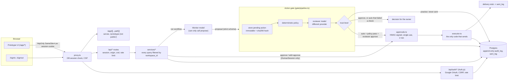
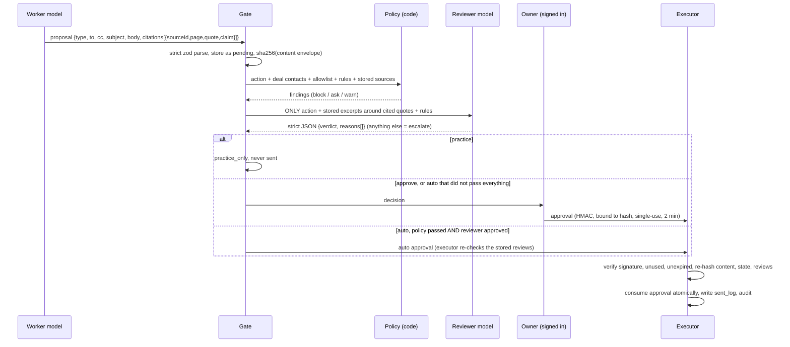

# Ida app (backend v0)

The first backend for Ida, a back-office assistant for independent real estate agents. Ida drafts and sends routine deal emails and asks the owner only for decisions.

This build has real Google sign-in and a real Postgres database, filled with the Dana Reyes sample world. It does not connect to Gmail. "Sending" writes a row to `sent_log`, and nothing leaves the server.

- **Stack:** Next.js 16 (App Router, TypeScript) on Vercel, Auth.js v5 with Google, Postgres through Drizzle ORM, zod, and vitest.
- **The core idea:** the model that drafts an action can never approve it or send it. See [The action gate](#the-action-gate).

## Architecture



| Path | What it is |
| --- | --- |
| `src/auth.ts` | Auth.js config: Google provider, database sessions, allowlist, OAuth tokens dropped |
| `src/proxy.ts` | Runs before every request. Signed-out users can reach only `/signin`, `/api/auth/*` and `/api/health` |
| `src/lib/gate/` | `action.ts` (schema + hash), `policy.ts`, `reviewer.ts`, `approvals.ts`, `pipeline.ts` |
| `src/lib/executor/` | `executor.ts` (verifies approvals and sends), `deliver-stub.ts` (writes `sent_log`) |
| `src/lib/worker/worker.ts` | Drafts actions. It can call only `propose` |
| `src/lib/services/` | Domain operations behind the API routes |
| `src/lib/api/handler.ts` | `apiRoute()`, the wrapper every API route goes through |
| `src/lib/db/schema.ts`, `drizzle/` | Schema and SQL migrations. `0001_guards.sql` adds the database-level guards |
| `src/lib/seed/` | Dana Reyes sample world (mirrors `site2/ida-store.js`) and the seeding code |
| `prototype/` | Copy of the static prototype, created by `npm run prototype:sync` |

**Why Drizzle and not Prisma:** Drizzle has no query-engine binary, which keeps serverless cold starts small. It runs the same code against `node-postgres` in production and in-process PGlite in tests. Its migrations are plain SQL files, which made it easy to add triggers that enforce the gate's invariants inside Postgres.

**Tenancy:** every domain table has a `workspace_id`, which is the tenant, called "account" in the product brief. The column isn't named `account_id` because Auth.js already owns a table called `accounts` for linked OAuth identities. Every service query filters by `workspace_id`, and that value always comes from the server-side session, never from the request. Cross-tenant access returns 404.

## The action gate



### How separation is enforced

1. **The worker can't send or approve.** `worker.ts` receives read-only context data and a single capability, `propose`. A test walks its import graph and fails if the worker can reach the executor, the approvals module, the gate pipeline, the database, the services or Auth.js. The worker's output is parsed with a strict schema, so a draft that carries `approved`, `status` or `approvalId` is rejected outright, not just stripped.
2. **Stored actions can't be changed.** A Postgres trigger rejects any update to an action's content, hash, type, recipients, workflow or deal, and rejects deletes. Only `status` can change. An owner edit creates a new version (`parent_id`) with its own hash.
3. **Deterministic policy runs first.** It is pure code with no model involved:
   - Every recipient must be on the deal or on the workspace allowlist.
   - Every citation must point to a source in this workspace and on this deal, at a real page, and its quote must appear in the stored page text.
   - The words a citation supports must appear in the draft.
   - Every number in a cited claim must appear in its quote.
   - Every factual sentence (one with numbers, money, dates or weekdays) must be covered by a valid citation, and its numbers must come from the cited quotes.
   - The owner's rules are matched with keyword, money or word-count matchers. Users can't supply their own regex, so there is no ReDoS risk.
   - An overstatement word list ("guaranteed", "definitely", "no issues", ...) is checked.
4. **An independent reviewer runs second.** `REVIEWER_MODEL` must differ from `WORKER_MODEL` and must come from a different provider. The server refuses to start otherwise (`src/instrumentation.ts`), and every use re-checks the rule. The reviewer gets only the action, excerpts from our own stored copy of each cited page (not the worker's quote) and the enabled rules. It never sees the worker's notes, prompt or conversation. Untrusted text is fenced as data. Its reply must be exactly `{"verdict":"approve|escalate|reject","reasons":[...]}`. Prose, fenced JSON, extra keys, a timeout or an HTTP error all count as **escalate**.
5. **The trust level decides what happens next.** `practice` actions are never sent. `approve` actions become a decision for the owner. `auto` actions are sent only if policy passed with no `block` or `ask` findings, the reviewer approved, and none of the workflow's apps is disconnected. Otherwise they go to the owner, with the reasons attached. A paused workflow holds the action and skips the reviewer call.
6. **Approvals are credentials.** An approval binds the workspace, action, content hash, approver and expiry, and is HMAC-SHA256-signed with `APPROVAL_SIGNING_SECRET`. Owner approvals require a `HumanSession`. Only `src/lib/api/session.ts` creates one, from a valid Auth.js database session whose email is still on the allowlist, and membership is checked again when the approval is issued. Auto approvals are issued only by the gate.
7. **The executor is the only sender.** Before sending, it:
   - verifies the signature;
   - rejects approvals that are used or expired;
   - re-hashes the stored content and compares the result with both the action's hash and the approval's hash, which detects edits made directly in the database;
   - checks the action's state;
   - for auto approvals, re-checks that the workflow is still `auto` and unpaused and that the stored policy and reviewer results for that exact hash passed;
   - for owner approvals, re-checks membership.

   It then consumes the approval with a conditional `UPDATE ... WHERE used_at IS NULL`, so only one of two concurrent attempts can win. Unique indexes allow at most one send per approval and per action. Every refusal is audited.
8. **The database backs this up.** `sent_log`, `audit_log` and `action_reviews` are append-only: triggers block UPDATE, DELETE and TRUNCATE. `0002_status_guards.sql` also lets an action's status move only forward along the gate's paths (a `practice_only` draft can never become sendable) and blocks TRUNCATE on `proposed_actions` and `approvals`. An executor row in `sent_log` must reference an approval (CHECK constraint). An approval can only have `used_at` set, and only once.

## API

All routes need a signed-in, allowlisted session. Without one they return `401`. Every write route also:

- requires a same-origin `Origin` header and `application/json`;
- is rate limited per user (60 per minute, or 10 per minute for `run`);
- validates params and body with strict zod schemas (unknown keys are rejected, bodies are capped at 64 KB).

`/api/auth/*` is rate limited per IP (20 per minute).

| Method | Route | Purpose |
| --- | --- | --- |
| GET | `/api/health` | Public liveness check |
| GET | `/api/decisions?status=open\|later\|done\|all` | Decisions with the draft, citations (with source titles), policy findings and reviewer verdict |
| POST | `/api/decisions/:id/approve` | `{contentHash}`. Approve and send. `contentHash` is required and must match the draft the owner saw (`action.contentHash` from `GET /api/decisions`) |
| POST | `/api/decisions/:id/edit-approve` | `{subject?, body?}`. Recipients can't be edited. Creates a new version, then approves and sends it |
| POST | `/api/decisions/:id/later` | Not now |
| GET/POST | `/api/tasks` | List tasks, or add one with `{name, area?, handToIda?}` |
| POST | `/api/tasks/:id/hand` | Hand a task to Ida. Creates a `practice` workflow |
| GET | `/api/workflows` | List workflows |
| PATCH | `/api/workflows/:id` | `{level?: practice\|approve\|auto, paused?}` |
| POST | `/api/workflows/:id/run` | `{dealId}`. Runs the worker once. The draft goes through the gate |
| GET/POST | `/api/rules` | List rules, or create one with `{text, kind: ask_first\|never\|style, keywords?}` |
| PATCH/DELETE | `/api/rules/:id` | Change `{text?, enabled?, keywords?}`, or delete. Locked rules return `403` |
| GET | `/api/sent` | Sent log |
| GET | `/api/apps` | Connected apps (stub, read-only) |
| GET | `/api/deals` | Deals |

## Security headers

- **Every response:** HSTS (2 years, preload), `nosniff`, `Referrer-Policy: strict-origin-when-cross-origin`, a restrictive `Permissions-Policy` and `COOP: same-origin`. `X-Frame-Options: DENY` is set everywhere except `/app/*`.
- **App pages (`/signin`, `/signout`):** a per-request nonce CSP with `'strict-dynamic'`, so there is **no `'unsafe-inline'` for scripts**. The pages are dynamically rendered, so Next.js applies the nonce to its own scripts. `form-action` allows `accounts.google.com`, because Chrome applies it to the redirect after sign-in.
- **API:** `default-src 'none'; frame-ancestors 'none'`. All responses are sent with `cache-control: no-store`.
- **Prototype (`/app/*`):** `script-src 'self'` plus SHA-256 hashes of the prototype's 4 inline `<script>` blocks, which `scripts/sync-prototype.mjs` computes. There is no `'unsafe-inline'` for scripts. `frame-ancestors 'self'` and `X-Frame-Options: SAMEORIGIN` are set because the prototype opens source documents in same-origin iframes. Responses use `cache-control: private, no-store`.
- **Exception:** `style-src 'unsafe-inline'` is allowed on app pages and the prototype. The prototype uses `style=""` attributes and sets styles from JavaScript. Inline styles can't execute code. The remaining risk is CSS-based data exfiltration through injected markup, which is low here because the prototype has no secrets in the DOM.
- **Client bundles:** no secrets reach them. No environment variable uses `NEXT_PUBLIC_`, and every secret is read in server-only modules.

## Local setup

Requirements: Node 20.9 or later (22 recommended) and Postgres 14 or later. Tests can run without Postgres.

```bash
npm ci
cp .env.example .env.local        # fill AUTH_SECRET, APPROVAL_SIGNING_SECRET, Google keys, ALLOWED_EMAILS
createdb ida_dev                  # or any Postgres; set DATABASE_URL
set -a; . ./.env.local; set +a
npm run db:migrate                # applies drizzle/*.sql
npm run db:seed -- you@example.com   # optional: pre-load the sample world for your account
npm run dev                       # http://localhost:3000 -> /signin -> Google -> /app/
```

Signing in for the first time also creates a workspace and loads the sample world automatically. For local Google sign-in, add `http://localhost:3000/api/auth/callback/google` to the OAuth client.

**Tests.** `npm test` runs the vitest suite on in-process PGlite: 125 tests covering the policy checks, reviewer parsing, gate routing, executor refusals, worker isolation, route auth and tenancy. `TEST_DATABASE_URL=postgres://postgres@localhost:5432/postgres npm run test:pg` runs the same suite on a real Postgres server, creating and dropping one database per test file. Both pass.

**Other commands:**

- `npm run prototype:sync -- ../site2` refreshes `prototype/` from the static prototype. The source folder is not modified.
- `npm run db:generate` creates a new migration after you change `schema.ts`.
- `npm run typecheck`
- `npm run build`

**Model modes.** `MODEL_MODE=mock` (the default) needs no keys. The mock worker drafts a cited update to the deal's first contact, and the mock reviewer approves. Put `[[mock:reject]]` or `[[mock:garbage]]` in a draft to see the reject and parse-failure paths. `MODEL_MODE=live` calls an OpenRouter-compatible `/chat/completions` endpoint.

## What the founder must set up to deploy

1. **Google OAuth client.** In Google Cloud Console, go to APIs & Services, then Credentials, and create an OAuth client ID of type "Web application".
   - **Consent screen:** External, in Testing mode, with your beta users added as test users. Scopes: `openid`, `email`, `profile` only.
   - **Authorized JavaScript origins:** `https://<your-domain>` and `http://localhost:3000`.
   - **Authorized redirect URIs:** `https://<your-domain>/api/auth/callback/google` and `http://localhost:3000/api/auth/callback/google`. Add `https://<project>.vercel.app/api/auth/callback/google` if you use the default Vercel domain.
   - Preview deployments get random URLs, so Google sign-in won't work on them unless you add each one. Use one stable domain for the beta.
2. **Postgres.** Add Neon from Vercel, then Storage, then Marketplace. Connect it to the project, and Vercel will inject `DATABASE_URL` (pooled) and an unpooled URL. Run migrations once from your machine against the **unpooled** URL:
   ```bash
   DATABASE_URL="<unpooled url>" npm run db:migrate
   ```
   Repeat this whenever `drizzle/` changes. The build doesn't run migrations on purpose.
3. **Environment variables.** Set these in Vercel under Project, then Settings, then Environment Variables, for Production. All of them are documented in `.env.example`.

   | Variable | Value |
   | --- | --- |
   | `AUTH_SECRET` | `npx auth secret` or `openssl rand -base64 32` |
   | `AUTH_GOOGLE_ID` | From step 1 |
   | `AUTH_GOOGLE_SECRET` | From step 1 |
   | `DATABASE_URL` | Pooled Neon URL, injected by the integration |
   | `ALLOWED_EMAILS` | Comma-separated beta emails |
   | `APPROVAL_SIGNING_SECRET` | `openssl rand -hex 32`, different from `AUTH_SECRET` |
   | `MODEL_MODE` | `mock` until you're ready |
   | `MODEL_API_KEY`, `WORKER_MODEL`, `REVIEWER_MODEL` | Only if `MODEL_MODE=live`. The two models must come from different providers, e.g. `openai/...` and `anthropic/...` |
   | `AUTH_URL` | Only if you use a custom domain: `https://<your-domain>` |

   The server refuses to start in production if any required variable is missing or the models are misconfigured.
4. **Deploy.** Import the repo in Vercel and keep the default build (`next build`). After you push, check that `GET /api/health` returns `{"ok":true}`, that `/app/` redirects to `/signin`, and that signing in with an allowlisted Google account works.

## Known limitations and open risks

See [SECURITY_REVIEW.md](SECURITY_REVIEW.md) for the independent security review, its fixes and the pre-launch checklist.


- **The prototype isn't wired to the API yet.** The pages under `/app/` still run on their own `localStorage` sample store (`ida-store.js`). The API serves the same sample world from Postgres. Switching the prototype's `store`/`act` calls to `fetch('/api/...')` is the next step.
- **Nothing is really sent.** Sending is a stub that writes `sent_log`, and Connected apps is read-only. A real Gmail integration must stay behind `executor.ts`. It also needs an outbox and idempotency key, because a real send can't be rolled back with the database transaction.
- **Factual-claim detection is a heuristic.** It catches sentences with numbers, money, dates and weekdays. Purely qualitative claims ("the roof looks good") are checked only when the draft cites them, plus by the reviewer model.
- **Owner edits skip the reviewer model.** The owner is the authority. Policy still runs, and its findings are recorded and audited.
- **Prompt injection.** Email text and documents are untrusted input to both models. The defenses are layered: deterministic policy runs first and doesn't involve a model, untrusted text is fenced, the verdict schema is strict, and anything unclear escalates. Even so, `auto` workflows should be enabled sparingly.
- **Database guards can be bypassed by the table owner.** Triggers enforce immutability and append-only logs, but the role that owns the tables (Neon's default role) can disable them. For production, run the app as a separate role with only `SELECT`/`INSERT` and the specific `UPDATE` columns it needs, and keep the owner role for migrations. An attacker with both database access and `APPROVAL_SIGNING_SECRET` could forge approvals. Keep that secret only in Vercel's environment.
- **Rate limiting is basic.** It is a fixed window in Postgres, keyed by user, or by IP for `/api/auth`. On Vercel the IP comes from `x-real-ip`, which the edge sets; elsewhere it is the right-most `x-forwarded-for` hop, never the client-supplied left-most one. Add Vercel WAF rules or Upstash if traffic grows.
- **Deleting a workspace is blocked.** The append-only triggers prevent cascading deletes, so account deletion needs an admin procedure, and data retention isn't defined yet.
- **Single-owner workspaces.** There is one workspace per user, with no team members, no device or session management UI, and a fixed 7-day session lifetime.
- **Auth.js v5 is still a beta release** (`next-auth@5.0.0-beta.32`, pinned). Watch for advisories.
- **`style-src 'unsafe-inline'`** is allowed, as described in [Security headers](#security-headers).
- **The proxy loads Auth.js lazily.** With Next 16.3 and Turbopack, a proxy file that statically imports the async `auth` export was not recognized as exporting `proxy`. The lazy import in `src/proxy.ts` works around this.
- **Sample history isn't gated.** `sent_log` rows marked `origin = 'sample_history'` are seeded history without approvals. The CHECK constraint requires approvals only for `origin = 'executor'`.
- **npm audit:** 0 known vulnerabilities, with `npm audit` and `npm audit --omit=dev`, as of this commit. `drizzle-kit` (dev only) bundles an old `esbuild` with a moderate advisory that only affects esbuild's dev server. An `overrides` entry in `package.json` pins it to `esbuild@0.25.12`, and `drizzle-kit generate` still works.
